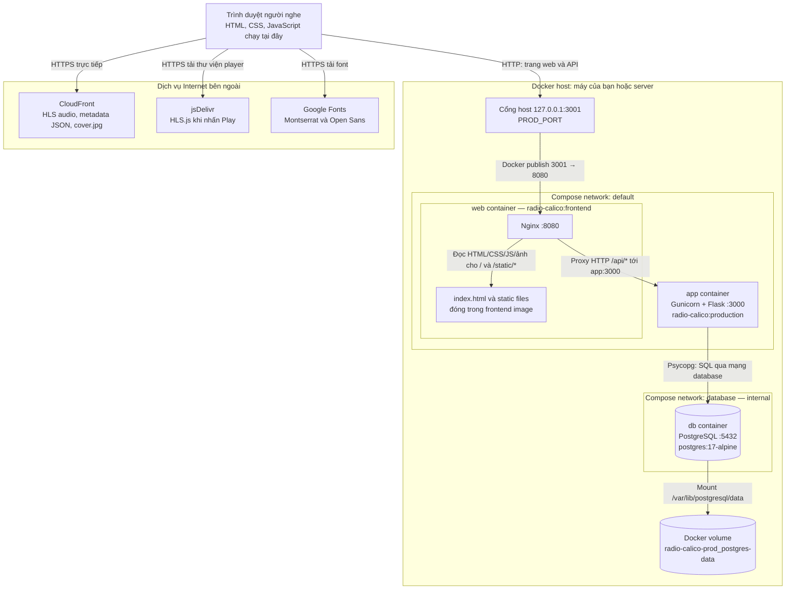
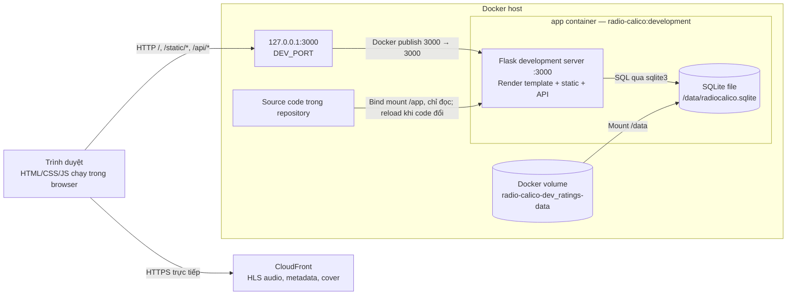
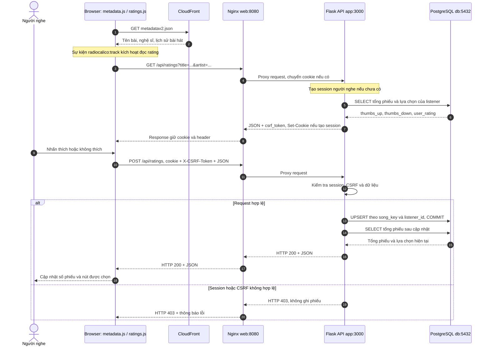
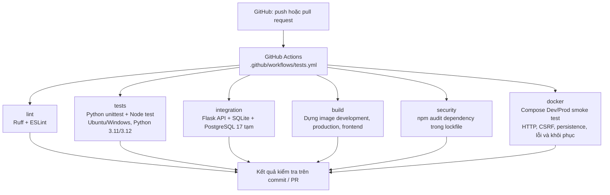

# Radio Calico — System Architecture Diagram

Sơ đồ mô tả kiến trúc hiện có trong repository. Mở file trên GitHub hoặc Markdown Preview có hỗ trợ Mermaid để xem hình. Chi tiết API và module: [ARCHITECTURE.md](ARCHITECTURE.md). Cách vận hành: [DOCKER.md](DOCKER.md).

## 1. Production — http://localhost:3001

- **Nginx phục vụ frontend:** trả HTML/CSS/JS/ảnh cho trình duyệt; JavaScript được thực thi trong trình duyệt.
- **Nginx proxy API:** `/api/ratings`, `/api/health`, `/api/playback-diagnostics` được chuyển tới Gunicorn/Flask.
- **Flask kết nối database:** backend tham gia cả network `default` và `database`; PostgreSQL chỉ ở network `database` nội bộ. Nginx không kết nối trực tiếp PostgreSQL.
- **Chỉ cổng Nginx được publish:** backend `3000` và PostgreSQL `5432` không mở thành cổng host.
- **Audio không qua backend:** trình duyệt tải HLS/metadata/cover trực tiếp từ CloudFront; CORS của các dịch vụ ngoài vẫn áp dụng. API nội bộ đi cùng origin qua Nginx.
- **Build và runtime:** `docker/render_frontend.py` dùng Flask/Jinja render template thành `index.html` khi build image. Sau đó Nginx phục vụ file đã render; mở trang Production không cần Flask render lại HTML hoặc truy vấn PostgreSQL.

Thứ tự khởi động theo health check: **PostgreSQL → backend → Nginx**. `/api/health` đi qua Nginx tới Flask và kiểm tra kết nối database.

## 2. Development — http://localhost:3000

Development dùng một container ứng dụng, không có Nginx hay PostgreSQL. Flask vừa gửi file frontend vừa xử lý API trên cùng origin. SQLite là file, không có cổng mạng. Các nguồn jsDelivr/Google Fonts được trình duyệt truy cập như Production.

Khi chạy Flask trực tiếp bằng Python ngoài Docker, luồng HTTP tương tự; SQLite mặc định nằm trong `data/` của repository thay vì Docker volume.

## 3. Bảng cổng và dữ liệu

| Môi trường / thành phần | Cổng trên host | Cổng trong container | Lưu trữ |
| --- | --- | --- | --- |
| Development Flask | `127.0.0.1:3000` | `app:3000` | SQLite trong volume Development |
| Production Nginx | `127.0.0.1:3001` | `web:8080` | HTML/static trong image |
| Production backend | Không publish | `app:3000` | Kết nối PostgreSQL |
| Production PostgreSQL | Không publish | `db:5432` | Volume PostgreSQL riêng |

Các cổng là mặc định hiện tại; `DEV_PORT`, `PROD_PORT`, `PROD_BIND` có thể thay đổi chúng. Tên volume trong sơ đồ dùng Compose project mặc định; đổi project name sẽ đổi tên volume. Container và volume được quản lý bởi Docker Engine đã chọn; Docker Desktop là một cách chạy/quản lý engine. Hai Docker engine độc lập không tự chia sẻ container hoặc volume.

SQLite Development và PostgreSQL Production độc lập, không tự đồng bộ hoặc migrate dữ liệu. Các volume giữ phiếu đánh giá và secret ký cookie qua lần tạo lại container. Không dùng `down --volumes` nếu cần giữ dữ liệu.

## 4. Luồng đánh giá bài hát trong Production

Backend chuẩn hóa title/artist rồi tạo `song_key` bằng SHA-256. `song_ratings` có khóa chính `(song_key, listener_id)`, nên đổi lựa chọn sẽ cập nhật phiếu hiện tại. Cookie `radiocalico_listener` có chữ ký, `HttpOnly`, `SameSite=Lax`; secret ký nằm trong `app_metadata`. Không có đăng nhập tài khoản; định danh gắn với cookie trình duyệt. Response API dùng `Cache-Control: no-store`.

Development có cùng luồng rating, với trình duyệt gọi thẳng Flask và Flask dùng SQLite thay cho PostgreSQL.

## 5. CI và quan hệ với triển khai

Các job chạy độc lập và báo kết quả riêng. Database/schema/project/volume dùng cho test được tạo tạm; kiểm tra không dùng database Production. npm audit bao gồm dependency phát triển ESLint, không quét thư viện Python, image Docker hoặc HLS.js tải từ CDN.

Workflow hiện là **CI**: chưa tự publish image lên registry hoặc deploy ứng dụng. Người vận hành chạy `make dev` / `make prod` để build và khởi động môi trường tương ứng. Đề xuất cache/nén/tối ưu tải trang ở [PERFORMANCE.md](PERFORMANCE.md) chưa được áp dụng vào runtime trong sơ đồ này.

## Các file cấu hình làm nguồn đối chiếu

- [compose.dev.yaml](compose.dev.yaml), [compose.prod.yaml](compose.prod.yaml): container, network, port và volume.
- [Dockerfile](Dockerfile), [docker/render_frontend.py](docker/render_frontend.py): image và render frontend lúc build.
- [docker/nginx.conf](docker/nginx.conf), [gunicorn.conf.py](gunicorn.conf.py): web server và API server.
- [app.py](app.py), [ratings.py](ratings.py), [database.py](database.py): route, session/CSRF và lưu trữ.
- [static/main.js](static/main.js), [static/metadata.js](static/metadata.js), [static/player/hls-loader.js](static/player/hls-loader.js): frontend và dịch vụ ngoài.
- [.github/workflows/tests.yml](.github/workflows/tests.yml): CI.
